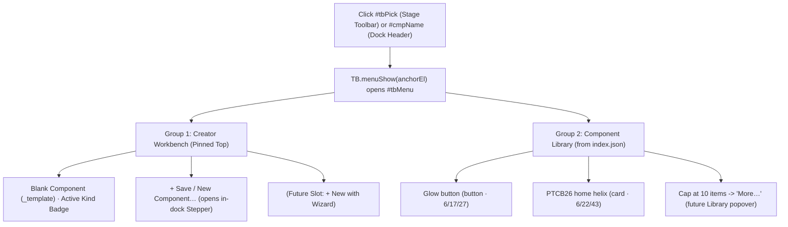
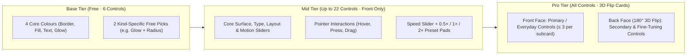

# Component Lab — Blank Component Workbench UI/UX & Workflow Transition Plan

---

## Executive Summary & Current-State Audit

An audit of the repository at commit `f710c07` (`feat/icons-dock`) confirms that while **P0** and **P1** abstracted schema-3 resolution (`lab/manifest.js`) and the base control bank (`components/_core/core.json`), the application's boot sequence, menu hierarchy, flip-card pairing, and help/status copy remain coupled to the **`helix`** showcase component:

1. **Helix-First Boot & Registry Order:**
   - `registry_order()` in `tools/check-components.py` forces `_template` to the **end** of `window.LAB_REGISTRY` (`['helix', 'glow-button', '_template']`), and `init()` in `lab/lab.js` boots into `reg[0]` (`helix`) whenever no `#c=` hash is present.
2. **Static, Read-Only `_template` ("TBD Type" Friction):**
   - `components/_template/manifest.json` hardcodes `"kind": "card"`, and `mount()` in `components/_template/component.js` only injects markup once if `.cmp-host` is empty. There is no way to switch component kinds (`card`, `button`, `nav`, `hero`, `list`, `modal`, `input`, `animated-background`) live while exploring the Blank Template, and clicking **`+` (New component)** in `startNew()` discards all values (`P`) tuned on `_template`.
3. **Pro 3D Flip-Card Pairing Bug on Non-Helix Components:**
   - In `fillPro()` of `lab/lab.js`, a single trailing `back` group (where all controls have `advanced: true`) is blindly paired onto the first `front` group that has no `advanced` items (`front.findIndex((g) => g.items.every((v) => !v.advanced))`). On `_template`, under **Surface**, `Effects` (`BLUR`, `advanced: true`) gets paired onto the back of `Opacity` instead of `Shape` or its own group, while **Type**, **Motion**, and **Layout** render multiple un-flipped subcards because optional controls in `core.json` lack `advanced: true` face assignments.
4. **Helix-Specific UI Copy & Labels:**
   - `Help.lowItems()` hardcodes *"four colours (8 swatches each) and two fade pads"* and *"Hover key (top) turns the hover pause on / off"*.
   - `core.json` and `autoGroup()` hardcode the primary colour subcard title as `"Card"` even when customizing a `button`, `nav`, `hero`, `input`, or `animated-background`.
   - `toVar()` in `lab/manifest.js` silently collapses `"section": "component"` into `'layout'` without placing component-specific controls at the top of the section.

---

## 1. Workflow & App Entry Transition

### 1.1 Creator-First Default Boot (`_template` Workbench First)
- **Default Boot Target:** Update `init()` in `lab/lab.js` so that when no `#c=<id>` hash is present in the URL, the lab boots into **`_template`** (the Blank Component Workbench), falling back to `reg[0]` only if `_template` is absent:
  ```js
  const DEFAULT_CMP = '_template';
  const first = (h.c && reg.includes(h.c)) ? h.c : (reg.includes(DEFAULT_CMP) ? DEFAULT_CMP : reg[0]);
  ```
- **Registry Ordering Alignment:** Update `registry_order()` in `tools/check-components.py` so `_template` is placed **first** in `window.LAB_REGISTRY` (`['_template', 'glow-button', 'helix']`), positioning the blank template first and `helix` as an advanced library showcase item.

### 1.2 Unified Component Switcher Menu (`#tbPick` & `#cmpName`)
Both the floating stage toolbar picker (`#tbPick`) and the expanded dock header title (`#cmpName`) already call `TB.menuShow(anchorEl)`. Instead of rendering a flat ungrouped list, upgrade `TB.menuShow()` using the loaded `components/index.json` metadata (`indexMeta` map) while keeping the existing `#tbMenu` container:



- **Menu Structure Inside `#tbMenu`:**
  1. **Workbench Header Action (`_template`):** Always first, labeled **`Blank component`** with a subtle pill showing its currently active kind (e.g., `Card` / `Button` / `TBD`).
  2. **`+ New component…` Action (Pro / Creator tier):** Directly below `Blank component` (separated by a hairline `.tb-sep`), clicking `+ New component…` closes `#tbMenu`, opens the dock if collapsed, and calls `startNew({ fromTemplate: def && def.id === '_template' })`. *(Note: In the future Wizard phase, `+ New with Wizard` will slot directly at the top of this group).*
  3. **Library Components List:** Lists all non-`_template` components from `window.LAB_REGISTRY`, displaying each component's `name` on the left and its `kind` badge on the right (`c.kind`).
  4. **Overflow Cap Constant (`MENU_CMP_CAP = 10`):** Show up to `10` library components (fits `1366×768` without scrolling); if `reg.length > MENU_CMP_CAP`, render a trailing **`More (N)…`** row that triggers a toast now and wires into the P2 Library popover later.

### 1.3 Seamless "Tune Blank Template → Save as New Component" Handoff
Currently, `_template` is read-only on disk (`serve.py` line 75), and clicking **`+`** on the rail resets `newDraft` to `{ kind: 'card', palette: 'project', name: '' }` and creates a fresh copy with unmodified defaults.
- **Fix:** When the user is viewing `_template`, tuning controls, and clicks either **`+`** on the rail or **`Save as new…`** in the Blank Template bar/Settings:
  - `startNew()` pre-populates `newDraft.kind = activeTemplateKind` and captures `newDraft.overrides = changedVarsSnapshot()` (every control where `P[v.id] !== v.default`).
  - Step 3 (`Name`) of `buildNew()` shows a summary line: `Tuned values: N modified controls carried over` (with a toggle to start clean if desired).
  - `createNew()` sends `{ name, kind: newDraft.kind, palette, title, overrides: newDraft.overrides }` to `POST /api/new`, so the newly scaffolded component boots with the exact look the user just designed in the Blank Component workbench.

---

## 2. Blank Component Template UI/UX Design

### 2.1 Live "TBD Type" Kind Switcher in the Existing Dock & Stage
Rather than creating a separate app page or modal, we use the existing dock header (`#cardHead`) and `_template` runtime so the Blank Component acts as a **polymorphic, multi-kind workbench**:

- **In-Dock Kind Strip (`#tplKindBar` inside `#cardHead`):**
  - Visible **only** when `def && def.id === '_template'` and on the controls home (`spec.type === 'cat'`).
  - Sits cleanly between the component title row (`.head-row`) and `#snapRow` / `#quickRow` as a horizontally scrollable or 2-row compact pill bar (`.tpl-kinds`) listing the **8 canonical component kinds**:
    `Card` · `Button` · `Nav` · `Hero` · `List` · `Modal` · `Input` · `Bg`
  - Includes a compact **`Save as +`** chip on the right end of the strip (Pro) that jumps straight to `startNew({ step: 2 })` (the Name step, since Kind and Colours are already chosen live on stage!).
- **What Happens When the User Clicks a Kind Pill on `_template` (`setTemplateKind(kind)`):**
  1. Stores `activeTemplateKind = kind` in `store.set('tplKind', kind)` (defaults to `'card'`).
  2. Re-resolves `_template`'s manifest in-memory by merging the base `_template/manifest.json` with the selected kind's profile from `components/_template/kinds.json` (`frames`, `hide`, `opt`, `freePicks`, `featured`, `defaults`, `interaction.mode`, and label `override`s).
  3. Preserves any shared core values (`COLOR_*`, `RADIUS`, `GLOW_STRENGTH`, etc.) the user already tweaked during the current `_template` session, while applying the new kind's defaults for untouched controls.
  4. Updates `frameEl` dimensions (`applyFrameVars()` + `layoutStage()`), notifies `inst.setKind(kind)` in `components/_template/component.js` to swap `.cmp-host` markup and `data-kind`, and re-renders the active dock section (`renderPage(0)`).

### 2.2 Visual Presentation of the Blank Template on the Sandbox Stage
- **8 Clean, Semantic Starter Blueprints in `components/_template/component.js` & `style.css`:**
  Every blueprint uses only CSS custom properties bound to `core@1` (`--c-border`, `--c-fill`, `--c-fill-2`, `--c-text`, `--c-muted`, `--c-accent`, `--c-glow`, `--fill-op`, `--border-op`, `--glow-k`, `--radius`, `--blur`, `--type-k`, `--label-k`, `--fw`, `--track`, `--w`, `--h`, `--pad`, `--gap`, `--lift`, `--ease`, `--speed`, `--intensity`) and responds to all 5 `IX_*` slots (`data-hover`, `data-press`, `data-drag`, `data-key`, `data-touch-off`):
  1. **`card` (`420×320`):** Eyebrow badge (`.cmp-badge`), heading (`.cmp-title`), 2-line body copy (`.cmp-text`), and action button (`.cmp-btn`).
  2. **`button` (`360×200`):** Centred interactive CTA button (`.cmp-btn.cmp-solo`) with leading/trailing SVG icon slot and hover sheen/glow.
  3. **`nav` (`560×140`):** Segmented pill navigation bar (`.cmp-nav`) with 4 items (`Overview`, `Components`, `Tokens`, `Export`), active indicator pill, and keyboard arrow/tab support.
  4. **`hero` (`820×420`):** Eyebrow kicker, display headline (`calc(var(--fs) * 1.85)`), subtitle lead, and dual CTA row (primary fill + secondary ghost button).
  5. **`list` (`420×340`):** Structured 4-row data list (`.cmp-list`) with status dot (`--c-accent`), label, secondary subtext, and right-aligned metric badge.
  6. **`modal` (`480×340` — NEW):** Elevated dialog surface (`.cmp-modal`) with header bar (title + close `×` badge), body message, divider, and footer action bar (`Cancel` + `Confirm`).
  7. **`input` (`420×220` — NEW):** Field group (`.cmp-input-group`) with label (`.cmp-label`), focusable input shell (`.cmp-field` with search/prompt icon, placeholder text, and trailing shortcut kbd badge), and helper hint line.
  8. **`animated-background` (`900×520`):** Ambient multi-blob aurora/mesh backdrop (`.cmp-bg` with `.b1`, `.b2`, `.b3` drifting on `--speed` and `--intensity`) with centred foreground title chip.
- **Stage Framing & Non-Intrusive Blueprint Guides:**
  - Keep `#stageFit` as the solid `--screen-bg` tablet surface with soft edge fade (`--screen-fade`).
  - Update `#stageNote` in `layoutStage()` so when `_template` is active, it reads:
    `Blank template · Kind: Card · frame 420 × 320 in 1600×770 · 100%`

### 2.3 Dynamic Dock Organization & Removal of Helix-Specific Copy
- **Dynamic Color Group Naming:**
  - In `LabManifest.resolve()`, if a control's group is `"Card"` (from `core.json`'s `COLOR_BORDER`, `COLOR_FILL`, `COLOR_FILL_2`) and the manifest does not explicitly override `group`, automatically map `"Card"` to `"Surface"` (or the capitalized `kind` label, e.g., `"Button"`, `"Nav"`, `"Hero"`, `"Modal"`, `"Input"`). This immediately fixes `"Color › Card"` appearing on buttons, navbars, and inputs.
- **First-Class Component-Specific Group Ordering:**
  - In `toVar()`, when an extra has `"section": "component"`, tag `v._isComponentExtra = true` while mapping `v.category = 'layout'` (keeping the 7 existing rail icons intact so no extra rail icon is needed), and update `groupsFor()` so any group containing `_isComponentExtra` ranks **first** (`-2000`) at the top of the `Layout` section (e.g., `Button` group in `glow-button` appears above generic `Size` / `Spacing`).
- **De-Helixing Help & Quick Key Copy (`lab/lab.js`):**
  - In `Help.lowItems()`, replace hardcoded *"two fade pads"* with dynamic names from `tierVars()` (e.g., *"4 core colours and 2 featured controls (Glow strength, Corner radius)"*) and replace *"turns the hover pause on / off"* with *"toggles the primary hover reaction on / off"*.

---

## 3. Parameter Taxonomy & Progressive Disclosure Hierarchy

### 3.1 Cognitive Load Rules & Fixing the 3D Flip-Card Architecture
To ensure the user is never overwhelmed while keeping full Pro depth one click away, every section in the dock follows a strict **3-Layer Progressive Disclosure Hierarchy**:



#### Fixing `fillPro()` and `miniCard()` in `lab/lab.js`
1. **Intra-Group Front/Back Split (Primary Mechanism):**
   - When a group `g` has both `!v.advanced` (front) and `v.advanced` (back) items, `miniCard()` renders a dual-sided 3D flip card (`g.name` ↔ `g.name · Adv`).
   - **Fix in `miniCard()`:** Remove the special-case `foldSingle` exception on line 1921 (`const foldSingle = !inAdv && (g.name === 'Opacity' || (rawMore.length === 1 && ...))`) whenever a group has `advanced: true` items that are explicitly meant for the flip back, OR only inline a single `advanced` item when total items in that group `<= 2`.
2. **Explicit Inter-Group Pairing (`FLIP_PAIRS` instead of blind `front[0]`):**
   - Replace the blind `pairedFrontIdx = back.length === 1 ? front.findIndex(...)` in `fillPro()` with a deterministic map of natural front/back group pairs:
     ```js
     const FLIP_PAIRS = {
       'Pointer': 'Touch & keys',
       'Shape': 'Effects',
       'Size': 'Spacing',
       'Loop': 'Depth'
     };
     ```
   - If a `back` group matches a `FLIP_PAIRS[frontGroup.name]`, it pairs onto that exact front group (so `Shape (Radius)` flips to `Effects (Backdrop blur)`, `Pointer` flips to `Touch & keys`, `Loop` flips to `Depth`). Any remaining standalone `back` groups pair two-by-two (preserving Helix's `Text fade ↔ Shell dim` and `End fade ↔ Border fill`).

### 3.2 Primary (Front) vs. Advanced (Flip Back) Control Breakdown by Section
By aligning `group` and `advanced` flags in `components/_core/core.json`, every section in Pro mode presents a compact, uncluttered front face with deep tuning on the 3D flip back:

| Rail Section | Subcard Group | Front Face (Primary · Free/Mid/Pro Front) | Back Face (3D Flip · Pro `advanced: true`) | Widget Types |
| :--- | :--- | :--- | :--- | :--- |
| **1. Color** | `Surface` *(or Kind label)* | `COLOR_BORDER` (Free), `COLOR_FILL` (Free) | `COLOR_FILL_2` (Gradient end, Pro) | Swatches / Arc / Role page |
| | `Text` | `COLOR_TEXT` (Free), `COLOR_ACCENT` (Mid/Pro) | `COLOR_MUTED` (Secondary text, Pro) | Swatches / Arc / Role page |
| | `Glow` | `COLOR_GLOW` (Free) | *(Single-row card, no flip needed)* | Swatches / Arc / Role page |
| **2. Interaction** | `Pointer` ↔ `Touch & keys` | `IX_HOVER` (Mid), `IX_PRESS` (Mid), `IX_DRAG` (Mid) | `IX_TOUCH` (Mid/Back), `IX_KEY` (Mid/Back) | Segmented pads & backlit pad |
| **3. Surface** | `Opacity` | `OPACITY_FILL` (Mid), `OPACITY_BORDER` (Mid) | *(2 clean sliders inline)* | Horizontal sliders (`0–1`) |
| | `Glow` | `GLOW_STRENGTH` (Free pick / Mid) | *(XDJ Beat-FX unit with preset pads)* | `fx-unit` (`0–3×`) |
| | `Shape` ↔ `Effects` | `RADIUS` (Free pick / Mid) | `BLUR` (Backdrop blur `0–30px`, Pro) | Rotary EQ knob ↔ H-slider |
| **4. Type** | `Size` ↔ `Style` | `SCALE_TEXT` (Mid), `SCALE_LABEL` (Pro front) | `WEIGHT` (Regular/Semi/Bold, Pro), `TRACKING` (Letter spacing, Pro) | H-sliders ↔ Seg-pads + H-slider |
| **5. Motion** | `Loop` ↔ `Depth` | `MOTION_EASING` (Settle/Spring/Linear, Mid), `HOVER_LIFT` (Mid/Pro), `IDLE` (Pad, Mid/Pro) | `MOTION_DIRECTION` (Pro), `DEPTH_PERSPECTIVE` (`200–2000px`, Pro) | Seg-pads + Knob + Pad ↔ Seg-pads + H-slider |
| **6. Rate** | `Tempo` | `MOTION_SPEED` (Mid slider+pads / Pro XDJ Tempo Deck) | `MOTION_INTENSITY` (`0–2×`, Pro), `MOTION_CYCLE` (`2–120s`, Pro) | Tempo Deck ↔ H-sliders |
| **7. Layout** | `<Kind>` *(when extras exist)* | Component-specific Mid extras (e.g. `BTN_ICON`, `BTN_SHEEN`) | Component-specific Pro extras (e.g. `BTN_SHEEN_ANGLE`, `BTN_PULSE`, `BTN_CASE`) | Seg-pads / Pads ↔ Knobs / Pads |
| | `Size` | `SIZE_W` (CH 1 vertical fader, Mid), `SIZE_H` (CH 2 vertical fader, Pro) | *(2-column mixer channel fader deck)* | Vertical channel faders |
| | `Spacing` | `SPACE_PAD` (Padding, Mid/Pro), `SPACE_GAP` (Gap, Mid/Pro) | *(2-column mixer channel fader deck or sliders)* | Vertical channel faders |

> **Progressive Disclosure Impact:** On `_template`, every single section in Pro mode now has **at most 2 to 3 subcards visible upfront**, and secondary controls (`COLOR_FILL_2`, `COLOR_MUTED`, `IX_TOUCH`, `IX_KEY`, `BLUR`, `WEIGHT`, `TRACKING`, `MOTION_DIRECTION`, `DEPTH_PERSPECTIVE`, `MOTION_INTENSITY`, `MOTION_CYCLE`) are tucked cleanly onto 3D flip-card backs!

### 3.3 Per-Kind Taxonomy Matrix (`components/_template/kinds.json`)
Expand `components/_template/kinds.json` from 6 to **8 component kinds**, each with curated `frames`, `hide` lists (controls that do not make sense for that kind), `opt` lists (optional `core@1` controls enabled for that kind), `freePicks` (the 2 non-colour controls shown in Base/Free), `featured` stars, and `defaults`:

| Kind ID | Label & Category | Frame (`1600×770` / `1366×768`) | `hide` (Suppressed Core Controls) | `opt` (Enabled Optional Controls) | `freePicks` (2 Base Controls) | Key Default Overrides |
| :--- | :--- | :--- | :--- | :--- | :--- | :--- |
| **`card`** | **Card** (`cards`) | `420×320` / `380×300` | `[]` *(all 12 core + 5 IX active)* | `COLOR_ACCENT`, `COLOR_MUTED`, `COLOR_FILL_2`, `BLUR`, `WEIGHT`, `TRACKING`, `SPACE_PAD`, `SPACE_GAP`, `HOVER_LIFT`, `IDLE`, `MOTION_INTENSITY`, `DEPTH_PERSPECTIVE` | `GLOW_STRENGTH`, `RADIUS` | `SIZE_W: 320`, `RADIUS: 16`, `SPACE_PAD: 22` |
| **`button`** | **Button** (`buttons`) | `360×200` / `340×180` | `SIZE_W`, `IX_DRAG` | `COLOR_ACCENT`, `BLUR`, `WEIGHT`, `TRACKING`, `SPACE_PAD`, `SPACE_GAP`, `HOVER_LIFT`, `IDLE` | `GLOW_STRENGTH`, `RADIUS` | `SCALE_TEXT: 0.96`, `RADIUS: 12`, `GLOW_STRENGTH: 1.2`, `SPACE_PAD: 16` |
| **`nav`** | **Nav / Tabs** (`menus`) | `560×140` / `520×130` | `IX_DRAG` | `COLOR_ACCENT`, `COLOR_MUTED`, `BLUR`, `WEIGHT`, `TRACKING`, `SPACE_PAD`, `SPACE_GAP`, `HOVER_LIFT` | `RADIUS`, `GLOW_STRENGTH` | `SIZE_W: 480`, `SPACE_PAD: 12`, `SPACE_GAP: 8`, `RADIUS: 16`, `IDLE: false` |
| **`hero`** | **Hero** (`heroes`) | `820×420` / `720×380` | `IX_DRAG` | `COLOR_ACCENT`, `COLOR_MUTED`, `COLOR_FILL_2`, `BLUR`, `WEIGHT`, `TRACKING`, `SCALE_LABEL`, `SPACE_PAD`, `SPACE_GAP`, `HOVER_LIFT`, `IDLE`, `MOTION_INTENSITY` | `SCALE_TEXT`, `GLOW_STRENGTH` | `SCALE_TEXT: 1.22`, `SIZE_W: 360`, `SPACE_PAD: 28`, `RADIUS: 20` |
| **`list`** | **List** (`cards`) | `420×340` / `380×310` | `IX_DRAG` | `COLOR_ACCENT`, `COLOR_MUTED`, `BLUR`, `WEIGHT`, `TRACKING`, `SCALE_LABEL`, `SPACE_PAD`, `SPACE_GAP`, `HOVER_LIFT` | `RADIUS`, `SCALE_TEXT` | `SIZE_W: 340`, `SPACE_PAD: 16`, `SPACE_GAP: 8`, `SCALE_TEXT: 0.94`, `IDLE: false` |
| **`modal`** *(New)* | **Modal** (`layouts`) | `480×340` / `440×310` | `IX_DRAG` | `COLOR_ACCENT`, `COLOR_MUTED`, `COLOR_FILL_2`, `BLUR`, `WEIGHT`, `TRACKING`, `SPACE_PAD`, `SPACE_GAP`, `DEPTH_PERSPECTIVE` | `RADIUS`, `GLOW_STRENGTH` | `SIZE_W: 380`, `RADIUS: 18`, `BLUR: 14`, `OPACITY_FILL: 0.92`, `SPACE_PAD: 24`, `IDLE: false` |
| **`input`** *(New)* | **Input / Form** (`layouts`) | `420×220` / `380×200` | `IX_DRAG`, `MOTION_SPEED` | `COLOR_ACCENT`, `COLOR_MUTED`, `BLUR`, `WEIGHT`, `TRACKING`, `SCALE_LABEL`, `SPACE_PAD`, `SPACE_GAP` | `RADIUS`, `GLOW_STRENGTH` | `SIZE_W: 320`, `RADIUS: 10`, `SPACE_PAD: 14`, `GLOW_STRENGTH: 0.8`, `IX_HOVER: "glow"` |
| **`animated-background`** | **Animated Bg** (`backgrounds`) | `900×520` / `760×460` | `SIZE_W`, `IX_DRAG`, `IX_PRESS` | `COLOR_ACCENT`, `COLOR_FILL_2`, `BLUR`, `SPACE_PAD`, `IDLE`, `MOTION_INTENSITY`, `MOTION_CYCLE`, `MOTION_DIRECTION` | `GLOW_STRENGTH`, `MOTION_SPEED` | `OPACITY_FILL: 1`, `GLOW_STRENGTH: 1.25`, `MOTION_INTENSITY: 1.15`, `HOVER_LIFT: 0` |

---

## 4. Scaffolding & Tooling Alignment

### 4.1 `components/_core/core.json` Updates
1. **Flip-Back (`"advanced": true`) Calibration on Optional Controls:**
   - Mark `WEIGHT` and `TRACKING` with `"advanced": true` so `Type › Size` (`SCALE_TEXT`, `SCALE_LABEL`) sits on the front and flips to `Type › Style` (`WEIGHT`, `TRACKING`) on the back (via `FLIP_PAIRS['Size'] = 'Style'` in `type`, or by placing `SCALE_TEXT`, `SCALE_LABEL`, `WEIGHT`, `TRACKING` in group `"Type"` where `WEIGHT` and `TRACKING` have `"advanced": true`).
   - Even simpler and cleaner: use **same-group `advanced: true`** in `core.json` so `miniCard()` automatically builds `<Group> ↔ <Group> · Adv` flip cards without cross-group side effects:
     - In `type`: put `SCALE_TEXT`, `SCALE_LABEL` (front) and `WEIGHT`, `TRACKING` (`"advanced": true`, back) in `"group": "Text"` (or keep `"Size"` ↔ `"Style"` in `FLIP_PAIRS`).
     - In `surface`: put `RADIUS` (front) and `BLUR` (`"advanced": true`, back) in `"group": "Shape & FX"` (or pair `'Shape': 'Effects'` in `FLIP_PAIRS`).
     - In `motion`: put `MOTION_EASING`, `HOVER_LIFT`, `IDLE` (front) and `MOTION_DIRECTION`, `DEPTH_PERSPECTIVE` (`"advanced": true`, back) in `"group": "Motion"` (or pair `'Loop': 'Depth'` in `FLIP_PAIRS`).
2. **Color Group Name Neutrality:**
   - Keep `"Card"` in `core.json` `groups.color` for backward compatibility with `helix`, while `LabManifest.resolve()` maps `"Card"` → `"Surface"` (or `kind` label) whenever `meta.id !== 'helix'`.

### 4.2 `lab/manifest.js` Updates
1. **Kind-Aware Resolution (`resolve(m, core, kindSpec)`):**
   - Extend `resolve(m, core, kindSpec)` with an optional 3rd parameter `kindSpec` (from `kinds.json[activeKind]`).
   - When `kindSpec` is passed (used when `_template` switches kinds live in the browser), `resolve()` overlays `kindSpec.frames`, `kindSpec.hide`, `kindSpec.opt`, `kindSpec.freePicks`, `kindSpec.featured`, and `kindSpec.defaults` onto a cloned copy of `m` before resolving `vars`:
     ```js
     function applyKindSpec(m, kindSpec, core) {
       if (!kindSpec) return m;
       const copy = clone(m);
       copy.meta = Object.assign({}, copy.meta, { kind: kindSpec.id || copy.meta.kind, category: kindSpec.category || copy.meta.category });
       if (kindSpec.frames) copy.frames = clone(kindSpec.frames);
       const c = copy.core = Object.assign({}, copy.core);
       const coreIds = new Set((core.controls || []).map((x) => x.id));
       if (kindSpec.opt) c.opt = clone(kindSpec.opt);
       if (kindSpec.freePicks) c.freePicks = clone(kindSpec.freePicks);
       c.hide = (kindSpec.hide || []).filter((h) => coreIds.has(h) && !(c.freePicks || []).includes(h));
       const ov = Object.assign({}, c.override);
       Object.keys(ov).forEach((k) => { if (ov[k]) delete ov[k].featured; });
       (kindSpec.featured || []).forEach((id) => { ov[id] = Object.assign({}, ov[id], { featured: true }); });
       Object.entries(kindSpec.defaults || {}).forEach(([id, val]) => { ov[id] = Object.assign({}, ov[id], { default: val }); });
       c.override = ov;
       return copy;
     }
     ```
2. **Component Section Priority Flag:**
   - In `toVar(src, mode)`, preserve `v._componentGroup = true` when `src.section === 'component'` so `groupsFor()` in `lab/lab.js` sorts component-specific groups to the top of `Layout`.

### 4.3 `new-component.py` & `serve.py` Updates
1. **Sync `new-component.py` with Enriched `kinds.json`:**
   - In `create()`, read `k.get("opt")` and `k.get("freePicks")` from `kinds.json` (in addition to `frames`, `hide`, `featured`, `defaults`) so every CLI or in-app scaffolded component gets the exact type-appropriate `opt` and `freePicks` for its kind.
   - Accept an optional `overrides=None` dictionary (`{ CONTROL_ID: value }`) in `create(name, kind="card", palette=None, title=None, category=None, tags=None, license="original", overrides=None)` and in `POST /api/new` in `serve.py`. Validated control values from the user's live `_template` session are written into `man["core"]["override"][cid]["default"]`, ensuring zero lost work when promoting the Blank Template to a named component.
   - Also stamp the selected `kind` into the newly copied `components/<name>/component.js` fallback (`const kind = (ctx && ctx.manifest && ctx.manifest.kind) || '<kind>';`) so standalone exports always know their kind.

### 4.4 `tools/check-components.py` Updates
1. **Put `_template` First in `registry_order()`:**
   ```python
   def registry_order():
       """_template first (creator workbench entry), then existing registry order, then any new folders."""
       reg = os.path.join(COMP, "registry.js")
       order = []
       if os.path.exists(reg):
           with open(reg, encoding="utf-8") as f:
               order = re.findall(r"'([^']+)'", f.read().split("[", 1)[-1])
       folders = sorted(d for d in os.listdir(COMP) if os.path.isfile(os.path.join(COMP, d, "manifest.json")) and NAME_RE.match(d))
       out = ["_template"] if "_template" in folders else []
       out += [d for d in order if d in folders and d != "_template"]
       out += [d for d in folders if d not in out and d != "_template"]
       return out
   ```
2. **Validate Every Kind Profile in `kinds.json`:**
   - Add a `check_kinds(core, errs)` step in `run()` that simulates resolving `_template/manifest.json` against each kind in `components/_template/kinds.json` and verifies that **every kind** passes `check_manifest()` (including the `Free <= 6` and `Free + Mid <= 22` tier budget checks!).

### 4.5 Future Component Wizard Boundary (Architecture Hook Only — Not Built Now)
- Per requirement **3.D**, the interactive multi-step Sandbox Component Wizard will be built in a separate future phase.
- To ensure this plan lays the exact foundation the Wizard will scaffold into:
  - `kinds.json` + `core.json` `tagVocab` + `LabManifest.applyKindSpec()` + `POST /api/new` (with `kind`, `palette`, `tags`, `overrides`) will serve as the single backend/manifest pipeline.
  - `#tbMenu` (in `TB.menuShow()`) and `#tplKindBar` will expose a clean hook (`window.__lab.startNew`) where the future Wizard stepper can attach without refactoring menu or manifest resolution code.

---

## 5. Phased Implementation Roadmap & Verification Plan

### Phase 1: Core Taxonomy, `kinds.json` (8 Kinds) & Validator Alignment
**Files to Modify:**
- `components/_core/core.json`
- `components/_template/kinds.json`
- `tools/check-components.py`

**Ordered Steps:**
1. Update `components/_core/core.json` optional controls (`WEIGHT`, `TRACKING`) with `"advanced": true` so Type/Surface/Motion groups split cleanly into Front (primary) and Back (`advanced: true`) faces.
2. Expand `components/_template/kinds.json` to all **8 kinds** (`card`, `button`, `nav`, `hero`, `list`, `modal`, `input`, `animated-background`), adding per-kind `opt`, `freePicks`, `hide`, `featured`, `defaults`, and `frames`.
3. Update `registry_order()` in `tools/check-components.py` to place `_template` first in `window.LAB_REGISTRY` and add `check_kinds()` validation so every kind in `kinds.json` is verified against `core@1` tier budgets (`Free <= 6`, `Mid <= 22`).

**Phase 1 Verification Criteria:**
- Run `python tools/check-components.py` — must exit `0` with `0 errors, 0 warnings`, confirming all 8 kind profiles in `kinds.json` and all 3 component manifests (`_template`, `glow-button`, `helix`) satisfy schema-3 rules and tier budgets.
- Confirm `components/registry.js` lists `'_template'` first.

---

### Phase 2: Blank Component (`_template`) 8-Kind Stage Blueprints & Live Kind Switching
**Files to Modify:**
- `components/_template/component.js`
- `components/_template/style.css`
- `lab/manifest.js`

**Ordered Steps:**
1. In `components/_template/component.js`, add semantic HTML blueprints for `modal` and `input` alongside `card`, `nav`, `hero`, `animated-background`, `list`, and `button`.
2. Add a `setKind(nextKind)` method on the object returned by `mount(frame, ctx)` in `components/_template/component.js` that updates `.cmp-host` `innerHTML` and `dataset.kind` whenever the kind changes dynamically.
3. In `components/_template/style.css`, add responsive CSS rules for `.cmp-modal` and `.cmp-input-group` wired to the `core@1` CSS custom properties (`--c-fill`, `--c-border`, `--c-accent`, `--c-text`, `--c-muted`, `--radius`, `--blur`, `--pad`, `--gap`, `--fs`, `--fw`, `--glow-k`).
4. In `lab/manifest.js`:
   - Add `applyKindSpec(m, kindSpec, core)` and pass optional `kindSpec` into `resolve(m, core, kindSpec)`.
   - Map default color group `"Card"` → `"Surface"` for non-`helix` components unless explicitly overridden.
   - Tag `section: "component"` extras with `v._componentGroup = true` so they sort to the top of `Layout`.

**Phase 2 Verification Criteria:**
- Run `node --check lab/manifest.js` and `node --check components/_template/component.js`.
- Verify `LabManifest.resolve()` in Node against all 8 kinds from `kinds.json` and confirm each resolves the expected `Free (6)`, `Mid (<= 22)`, and `Pro` control counts.

---

### Phase 3: Dock UI/UX, Live Kind Bar, 3D Flip Pairing Fix & Menu De-Helixing
**Files to Modify:**
- `lab/lab.js`
- `lab/dock.css`
- `lab/lab.css`

**Ordered Steps:**
1. **Default Boot:** Update `init()` in `lab/lab.js` to boot into `_template` by default when no `#c=` hash is provided.
2. **In-Dock Kind Switcher Bar (`#tplKindBar`):**
   - Add `KIND_GLYPH.modal` and `KIND_GLYPH.input` in `lab/lab.js`.
   - Render `#tplKindBar` in `#cardHead` when `def.id === '_template'` and on the controls home (`spec.type === 'cat'`), allowing one-click switching across `Card · Button · Nav · Hero · List · Modal · Input · Bg` plus a `Save as +` chip.
   - Implement `setTemplateKind(kind)` in `lab/lab.js` to re-resolve `man` with `kindsInfo.kinds[kind]`, update `frameEl` frame dimensions, call `inst.setKind(kind)`, and refresh the dock controls in place.
3. **Structured Component Switcher Dropdown (`TB.menuShow`):**
   - Update `TB.menuShow()` so `#tbPick` and `#cmpName` render:
     - Top pinned section: `Blank template` (with active kind badge) + `+ New component…` (in Pro).
     - Divider + Library components with `kind` badges and `MENU_CMP_CAP = 10` overflow handling.
4. **Pro 3D Flip-Card Pairing Fix (`fillPro` & `miniCard`):**
   - Update `fillPro()` to use `FLIP_PAIRS` (`Pointer ↔ Touch & keys`, `Shape ↔ Effects`, `Size ↔ Style`, `Loop ↔ Depth`) instead of blindly pairing onto `front[0]`, and update `groupsFor()` to sort `_componentGroup` first in `Layout`.
5. **De-Helix Help & Quick-Hover Copy:**
   - Update `Help.lowItems()` and `paintQuick()` so all descriptions dynamically reflect the active component's `freePicks` and `interaction.mode`.

**Phase 3 Verification Criteria:**
- Run `node --check lab/lab.js`.
- Load `http://127.0.0.1:5179/?reset` and verify:
  - The app boots into **Blank template (`_template`)** on the stage and in the dock header.
  - Clicking each of the 8 kind pills in `#tplKindBar` immediately updates the stage preview markup, frame dimensions, and dock controls without console errors.
  - In Pro mode, **Surface** pairs `Shape (Corner radius)` ↔ `Effects (Backdrop blur)` (leaving `Opacity` clean), **Type** pairs `Size` ↔ `Style`, **Interaction** pairs `Pointer` ↔ `Touch & keys`, and **Motion** pairs `Loop` ↔ `Depth`.
  - Switching to `helix` (`#c=helix`) still renders all 43 controls (`6 / 22 / 43`) identically to the P0 audit baseline.

---

### Phase 4: Scaffolding Carry-Over ("Save Blank Template as New Component")
**Files to Modify:**
- `new-component.py`
- `serve.py`
- `lab/lab.js`

**Ordered Steps:**
1. Update `create()` in `new-component.py` to apply `k.get("opt")`, `k.get("freePicks")`, and optional `overrides` dict (writing user-tuned default values from `_template` into `core.override`), and stamp the chosen `kind` into `component.js`.
2. Update `POST /api/new` in `serve.py` to pass `body.get("overrides")` to `new_component.create()`.
3. Update `startNew()`, `buildNew()`, and `createNew()` in `lab/lab.js` so starting a new component from `_template` pre-selects `activeTemplateKind` and carries over modified parameter values `P`.

**Phase 4 Verification Criteria:**
- Tune 3 controls on `_template` (e.g., switch kind to `modal`, change `COLOR_ACCENT`, `RADIUS`, `BLUR`), click `Save as +` (or `+` on the rail), name it, and click **Create**:
  - Verify `components/<new-id>/manifest.json` passes `tools/check-components.py` and boots with the `modal` kind and all 3 tuned defaults preserved.

---

### Phase 5: End-to-End Verification & Documentation Sync
**Files to Modify:**
- `README.md`
- `COMPONENT-LAB-ANALYSIS-REFERENCE.md`

**Verification Checklist:**
1. **Static & Validator Checks:**
   - `python tools/check-components.py` → `0 errors, 0 warnings`.
   - `node --check` across all `lab/*.js` and `components/*/component.js` files.
2. **Viewport & Tier Matrix (`1600×770` and `1366×768` across `free`, `mid`, `pro`):**
   - Verify `_template` across all 8 kinds (`card`, `button`, `nav`, `hero`, `list`, `modal`, `input`, `animated-background`): centered in `#labFrame`, `0` console errors, `Free = 6`, `Mid <= 22`, and `Pro` flip cards operate smoothly.
   - Verify `glow-button` (`6 / 17 / 27`) and `helix` (`6 / 22 / 43`) retain full parity.
   - Run `http://127.0.0.1:5179/?selftest=1` and confirm all registered components pass smoke testing and standalone HTML export (`workingFile()`).

